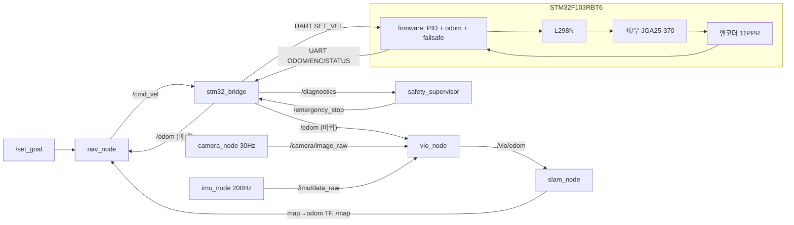

# 시스템 설계 — 노드 구조 및 데이터 흐름 (P0-3)

- 작성일: 2026-11-24
- 기반: `project.md` Phase 0, `docs/HARDWARE_BOM.md`, `docs/TF.md`(예정)
- 상태: **초안 — `R0-3` 검토 예정**

## 1. 설계 원칙

1. **MCU는 모터/엔코더/안전만 담당**한다. VIO·SLAM·경로계산은 Pi에서 수행한다.
   - STM32F103RBT6은 FPU가 없고 RAM 20KB로 제한적이므로 복잡한 연산을 올리지 않는다.
2. **인터페이스 먼저, 구현 나중**. 노드 경계와 토픽은 `docs/INTERFACES.md`(P0-4)에서 확정한다.
3. **단일 권한 원칙**: 한 시점에 한 노드만 `odom→base_link` TF를 발행한다. (§4)
4. **실패 격리**: 센서 하나가 죽어도 로봇은 정지할 수 있어야 한다. 안전은 MCU의 하드웨어 failsafe가 최후 보장한다.
5. **오프라인 재현**: 모든 단계는 rosbag로 재생·검증 가능해야 한다.

## 2. 노드/컴포넌트 목록

| 노드 | 실행 위치 | 주요 입력 | 주요 출력 | 주기 | 실패 시 영향 |
|---|---|---|---|---|---|
| `firmware` (노드 아님) | STM32 | UART 명령, 엔코더 A/B | L298N PWM/방향, UART 피드백 | 제어 100Hz / 피드백 50Hz | 모터 정지 (failsafe) |
| `stm32_bridge` | Pi | `/cmd_vel`, `/emergency_stop` | UART `SET_VEL`/`ESTOP`, `/odom`, `/diagnostics` | 50Hz | 로봇 강제 정지, VIO prior 손실 |
| `camera_node` | Pi | CSI (Module 3, libcamera) | `/camera/image_raw`, `/camera/camera_info` | 30Hz | VIO/SLAM 중단 |
| `imu_node` | Pi | SPI (ICM-20948) | `/imu/data_raw` | 200Hz | VIO 자세 추정 열화 |
| `vio_node` | Pi | 이미지, IMU, 바퀴 odom | `/vio/odom` (이후 `odom→base_link`) | 30Hz | 위치 추정 손실 → 바퀴 odom fallback |
| `slam_node` | Pi | 이미지, `/vio/odom` | `map→odom` TF, `/map`, 맵 파일 | 10~30Hz | 재위치 불가, Nav는 정적 맵 사용 |
| `nav_node` | Pi | `/set_goal`, 맵, odom | `/cmd_vel` | 20~50Hz | 목표 미도착, 정지 유지 |
| `safety_supervisor` | Pi | `/diagnostics`, 하트비트, estop 요청 | `/emergency_stop`, 경고 로그 | 10Hz | 최후 방어: bridge 정지 시 전원 차단 권고 |

패키지 구조(안): `ros2_ws/src/stm32_bridge`, `robot_description`(URDF/RViz), `robot_bringup`(런치), 이후 `vio`, `slam`, `nav`, `safety`.

## 3. 데이터 흐름



### 제어 루프 요약

```
사용자 goal → nav_node → /cmd_vel → stm32_bridge → UART(SET_VEL)
  → STM32 PID(100Hz) → L298N → 모터 → 엔코더
  → STM32 odom → UART(50Hz) → /odom → VIO/SLAM → nav_node (폐루프)
```

- 명령이 500ms 이상 끊기면 MCU가 모터를 정지합니다 (`P1-7`).
- `/emergency_stop`은 MCU의 `ESTOP` 프레임과 하드웨어 failsafe를 모두 경유합니다.

## 4. TF 발행 권한 (단계별 변경)

| 단계 | `odom→base_link` 발행자 | `map→odom` 발행자 | 비고 |
|---|---|---|---|
| Phase 2 | `stm32_bridge` (바퀴 odom) | 없음 (identity) | ROS 통합 검증 |
| Phase 4 | `vio_node` | 없음 (identity) | 바퀴 odom은 `/wheel/odom`으로 분리해 prior로만 사용 |
| Phase 5+ | `vio_node` | `slam_node` | 루프 클로저 시 map→odom 보정 |

> **중요 (검토 필요)**: Phase 2에서 검증한 `/odom`→TF 구조가 Phase 4에서 바뀝니다. 전환 시점과 fallback 규칙은 `R4-1`에서 다시 승인합니다.

## 5. Phase별 노드 활성화

| Phase | 활성 노드 | 검증 초점 |
|---|---|---|
| 1 | (MCU 펌웨어만) | 주행, 엔코더, PID, failsafe |
| 2 | `stm32_bridge` + URDF/RViz | ROS 제어, odom 시각화 |
| 3 | + `camera_node`, `imu_node` | 센서 동기화, rosbag 재현 |
| 4 | + `vio_node` | 궤적 추정, ATE/RPE |
| 5 | + `slam_node` | 맵, 루프 클로저, 재위치 |
| 6 | + `nav_node`, `safety_supervisor` | Goal → 주행 → 도착, 안전 |
| 7 | 전체 | 통합/성능/재현 |

## 6. 실패 전파 및 격리

| 실패 | 1차 대응 | 최후 방어 |
|---|---|---|
| UART 단절 | bridge 재연결 시도 | MCU timeout → 모터 정지 |
| 카메라 드롭 | VIO가 IMU+바퀴 odom으로 유지 | 일정 시간 초과 시 정지 |
| IMU 드롭 | VIO가 바퀴 odom fallback | 정지 |
| SLAM 트래킹 loss | relocalization 시도 | Nav 정지, 수동 복구 |
| Nav 목표 미도착 | recovery(후진/재계획), 횟수 제한 | safety_supervisor estop |

## 7. R0-3에서 검토할 포인트

1. 노드 분리가 과하지 않은가? (`vio`, `slam`, `nav`를 나눌지)
2. IMU를 Pi가 읽어 VIO로 보내는 구조가 적합한가? (대안: MCU 경유 → 지연 증가)
3. §4의 TF 발행 권한 전환(Phase 2 → 4)을 이 시점에 확정할지, `R4-1`로 미룰지
4. `safety_supervisor`를 Pi 소프트웨어로 둘지, MCU 하드웨어에 더 위임할지
5. 카메라 30Hz / IMU 200Hz / 제어 100Hz 조합이 Pi 5 + Jazzy에서 감당 가능한지

## 8. 다음 단계

`R0-3` 승인 후 `P0-4`(토픽/메시지/서비스/QoS 명세)로 진행합니다.
