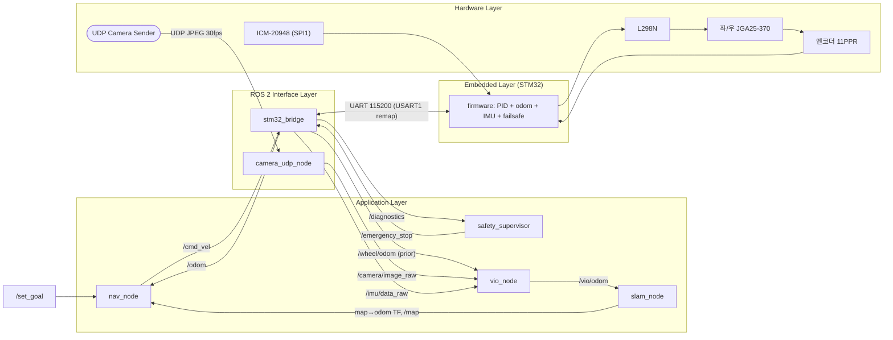

# 시스템 설계 — 계층 구조 및 데이터 흐름 (P0-3)

- 작성일: 2026-11-24 / 수정: 2026-11-26 (사용자 주석 반영)
- 근거: `project.md` Phase 0, `docs/HARDWARE_BOM.md`, `plan.md` §3/§5
- 상태: **초안 — R0-3 검토 대기** (사용자 주석 반영 완료, 게이트 미승인)

## 1. 계층 구조

구체적인 칩 이름 대신 **역할 계층**으로 구조를 기술하고, 실제 부품 매핑은 별도 표로 분리합니다.

| 계층 | 역할 | 포함 요소 |
|---|---|---|
| **Application Layer** | 목표→추정→계획→제어 결정 | `vio_node`, `slam_node`, `nav_node`, `safety_supervisor` |
| **ROS 2 Interface Layer** | 프로토콜 변환, ROS 토픽 발행 | `stm32_bridge`, `camera_udp_node` |
| **Embedded Layer** | 실시간 모터 제어, 센서 샘플링, 안전 | STM32 펌웨어 (PID, 엔코더, IMU, failsafe) |
| **Hardware Layer** | 물리 장치 | IMU, 엔코더, 모터 드라이버, 모터, UDP 카메라 송신기 |

### 부품 ↔ 계층 매핑

| 계층 요소 | 실제 부품 |
|---|---|
| Embedded Layer | STM32F103RBT6 (72MHz, RAM 20KB, FPU 없음) |
| IMU | ICM-20948, **SPI1** (PA5/PA6/PA7), CS=PA4, polling 50Hz (DRDY 미사용) |
| 엔코더 | JGA25-370 내장 11PPR 2채널 × 2 |
| 모터 드라이버 | L298N (2A/ch) |
| 모터 | JGA25-370 12V 130RPM(출력축), 감속비 46.8:1 |
| UDP 카메라 송신기 | 별도 송신 장치 → 640×480@30 JPEG UDP 스트림 |
| ROS 2 Interface | Raspberry Pi 5 8GB, Ubuntu 24.04, ROS 2 Jazzy |

## 2. 계층별 노드/컴포넌트

| 계층 | 노드 | 입력 | 출력 | 주기 | 실패 시 영향 |
|---|---|---|---|---|---|
| Hardware | IMU (ICM-20948) | SPI1 polling (CS=PA4) | 가속도/자이로 | **현재 50Hz**, 목표 200Hz 미결정 | VIO 자세 열화 |
| Hardware | 엔코더 | 모터 회전 | A/B 펄스 | — | odom 정지 |
| Embedded | `firmware` | UART 명령, 엔코더, IMU | L298N PWM/방향, UART 피드백 | **PWM 1kHz**, cmd 이벤트 수신, odom 50Hz, IMU 50Hz, **PID 미구현** | 모터 정지 (failsafe 미구현) |
| ROS Interface | `stm32_bridge` | `/cmd_vel`, `/emergency_stop`, UART 프레임 | `SET_VEL`/`ESTOP`, `/odom`, `/wheel/odom`, `/imu/data_raw`, `/diagnostics` | 50Hz | 로봇 강제 정지, VIO prior 손실 |
| ROS Interface | `camera_udp_node` | UDP JPEG 스트림 | `/camera/image_raw`, `/camera/camera_info` | 30Hz | VIO/SLAM 중단 |
| Application | `vio_node` | 이미지, `/imu/data_raw`, `/wheel/odom` | `/vio/odom` (이후 `odom→base_link`) | 30Hz | 바퀴 odom fallback |
| Application | `slam_node` | 이미지, `/vio/odom` | `map→odom` TF, `/map`, 맵 파일 | 10~30Hz | 재위치 불가 |
| Application | `nav_node` | `/set_goal`, 맵, odom | `/cmd_vel` | 20~50Hz | 목표 미도착, 정지 |
| Application | `safety_supervisor` | `/diagnostics`, 노드 하트비트 | `/emergency_stop`, 경고 로그 | 10Hz | 소프트웨어 이상 감지 시 정지 |

> `imu_node`는 제거되었습니다. IMU는 MCU가 읽어 UART로 보내고 `stm32_bridge`가 `/imu/data_raw`를 발행합니다.

## 3. 데이터 흐름



### 제어 루프

```
goal → nav_node → /cmd_vel → stm32_bridge → UART(SET_VEL)
  → STM32 PWM(1kHz, 현재 PID 없음) → L298N → 모터 → 엔코더(TIM3 IC)
  → STM32 odom(50Hz) + IMU(50Hz) → UART → bridge → /odom, /wheel/odom, /imu/data_raw
  → vio_node → slam_node → nav_node (폐루프)
```

## 4. 핀 매핑 및 통신 — 실제 펌웨어 기준

> `firmware/Test/Core/Src/{main.c, motor.c, imu.c, stm32f1xx_hal_msp.c}`에서 확인한 값입니다. 기존 설계안과 다른 부분은 §4.3에 정리했습니다.

### 4.1 실제 핀 배치

| 신호 | STM32 핀 | 펌웨어 설정 | 근거 |
|---|---|---|---|
| IMU SPI1 | PA5(SCK) / PA6(MISO) / PA7(MOSI) | master, 8bit, prescaler 64, **NSS software** | `MX_SPI1_Init`, `IMU_Init` |
| IMU CS | **PA4** (GPIO output) | `HAL_GPIO_WritePin(GPIOA, GPIO_PIN_4, ...)` | `IMU_Init` |
| IMU DRDY | **사용 안 함** (polling) | `Get_Gyro/Get_Accel` 반복 호출 | `StartImuCalTask` |
| Pi↔MCU UART | **USART1 remap: PB6(TX) / PB7(RX)** | **115200** 8N1, RX DMA + TX mutex | `MX_USART1_UART_Init`, `HAL_UARTEx_RxEventCallback` |
| 디버그 UART | USART2: PA2(TX) / PA3(RX) | 115200, `printf` retarget | `_write` → `HAL_UART_Transmit(&huart2, ...)` |
| 좌/우 PWM | **TIM1 CH2(PA9) / CH3(PA10)** | PSC=71, ARR=1000 → **1kHz** | `MX_TIM1_Init`, `Motor_Init` |
| 좌/우 엔코더 | **TIM3 remap: CH1(PC6) / CH3(PC8)** | input capture, period 65535, NO prescaler | `MX_TIM3_Init`, `HAL_TIM_IC_CaptureCallback` |
| L298N 방향 | PC0/PC1(좌 IN1/IN2), PC2/PC3(우 IN1/IN2) | GPIOC output push-pull | `Motor_Init`, `MX_GPIO_Init` |
| PC4 | GPIOC output, IMU 태스크에서 SET | **용도 미확인** (전원/enable 추정) | `StartImuCalTask` line 655 |

- TIM3은 `__HAL_AFIO_REMAP_TIM3_ENABLE()`로 **full remap**되어 CH1→PC6, CH3→PC8입니다.
- USART1도 `__HAL_AFIO_REMAP_USART1_ENABLE()`로 **remap**되어 PB6/PB7을 사용합니다. (기본 PA9/PA10이 아님 → PWM과 충돌 없음)

### 4.2 현재 UART 프레임 및 대역

프레임: `0xAA | CMD(1B) | payload | 0xFF` — `CMD_IMU=0`, `CMD_ODOM=1`, `CMD_VEL=2`. **SEQ/CRC 없음.**

| 메시지 | 주기 | 크기 | 사용량 |
|---|---|---|---|
| IMU (`CMD_IMU`, float×6) | **50Hz** (`osDelay(20)`) | 27B | 1350 B/s |
| Odom (`CMD_ODOM`, int32×2) | 50Hz | 11B | 550 B/s |
| Cmd (`CMD_VEL`, float×2) | 50Hz | 11B | 550 B/s |
| **합계** | | | **약 2450 B/s (24.5kbps)** |

→ 115200bps(11520 B/s) 기준 사용률 약 **21%**입니다. IMU를 200Hz로 올려도 약 56%이므로 **현재 속도로 충분**합니다. 230400은 선택 사항입니다.

### 4.3 설계안 vs 펌웨어 차이 (R0-3 검토 필요)

| 항목 | 이전 설계안 | 현재 펌웨어 | 판단 필요 |
|---|---|---|---|
| Pi↔MCU UART | USART2 PA2/PA3, 230400 | **USART1 remap PB6/PB7, 115200** | 현재 유지 가능. 그대로 확정? |
| IMU 출력률 | 200Hz | **50Hz** | VIO에 50Hz로 충분한지 판단 |
| 엔코더 | quadrature A/B ×4 → 2059.2 count/rev | **단일 채널 input capture**, 방향은 명령 부호로 추정 → 11×46.8 = **514.8 count/rev**(에지 수 확인 필요) | `P1-3`에서 실측 후 상수 확정 |
| 프레임 | SOF+SEQ+ID+LEN+CRC16 | SOF+CMD+payload+EOF, CRC 없음 | `P0-6`에서 SEQ/CRC 추가 여부 |
| IMU 샘플링 | DRDY 인터럽트 | polling 50Hz | 지터 허용 여부 |
| 모터 제어 | PID 50~100Hz | **PID 없음**, cmd duty를 그대로 PWM에 반영 | `P1-4`에서 구현 |

> 위 차이는 "잘못된 코드"가 아니라 **아직 구현 전인 설계 항목**입니다. 게이트에서 어떤 것을 펌웨어 기준으로 유지하고 어떤 것을 추가할지 결정합니다.

## 5. TF 발행 권한

| 단계 | `odom→base_link` | `map→odom` | 엔코더 odom |
|---|---|---|---|
| Phase 2 | `stm32_bridge` (바퀴 odom) | 없음 | `/odom` |
| **Phase 4** | `vio_node` | 없음 | **`/wheel/odom`으로 분리 → VIO prior** |
| Phase 5+ | `vio_node` | `slam_node` | 동일 |

- 엔코더 odom은 VIO의 **스케일/속도 prior**로 투입해 SLAM 성능을 높입니다. 단 `odom→base_link` 발행자는 VIO **하나만** 유지해 TF 충돌을 막습니다.
- ORB-SLAM3은 wheel odom을 직접 입력받지 못하므로 **VIO 퓨전 결과를 경유**합니다.
- Phase 2 → 4 전환 시점은 `R4-1`에서 재확인합니다.

## 6. 안전 2계층

| 계층 | 주체 | 감지 대상 | 대응 |
|---|---|---|---|
| 소프트웨어 | `safety_supervisor` (Pi) | 노드 하트비트, VIO/SLAM 실패, 목표 미도착 무한 반복 | `/emergency_stop` 발행, 로그 |
| 하드웨어 | STM32 failsafe | **UART 연결 끊김**, 명령 timeout 500ms, ESTOP 프레임, 저전압 | 모터 PWM 즉시 0 |

- UART가 끊기면 Pi의 소프트웨어 supervisor는 명령을 보낼 수 없으므로 **MCU가 독립적으로 정지**해야 합니다. 두 계층은 서로를 대체하지 않고 상호 보완합니다.

## 7. Phase별 노드 활성화

| Phase | 활성 계층/노드 | 검증 초점 |
|---|---|---|
| 1 | Embedded + Hardware | 주행, 엔코더, IMU, PID, failsafe |
| 2 | + `stm32_bridge` + URDF/RViz | ROS 제어, odom 시각화 |
| 3 | + `camera_udp_node`, IMU 파이프라인 | 센서 동기화, rosbag 재현 |
| 4 | + `vio_node` | 궤적 추정, ATE/RPE |
| 5 | + `slam_node` | 맵, 루프 클로저, 재위치 |
| 6 | + `nav_node`, `safety_supervisor` | Goal → 주행 → 도착, 안전 |
| 7 | 전체 | 통합/성능/재현 |

## 8. R0-3 주석 처리 결과

| 주석 | 결정 |
|---|---|
| "MCU에 IMU 달거임" / "SPI1임" | 반영. SPI1 유지 + **펌웨어 실제 핀맵 반영(§4)**. UART는 USART1 remap PB6/PB7 115200, 타임스탬프/CRC는 미구현 → `P0-6` 과제 |
| "카메라는 UDP 통신으로 할거임" | 반영. `camera_udp_node`가 UDP JPEG 수신. 세부 포트/패킷 형식은 `P0-4`에서 확정 |
| "Hardware Layer 식으로" | 반영. 4계층 구조 + 부품 매핑 표(§1) |
| "노드 분리 괜찮아" | 노드 분리 유지 |
| "IMU MCU 연결 지연?" | 펌웨어는 50Hz polling이라 타임스탬프 없음. 200Hz 전환 시 약 3~6ms + 지터 보상 필요 |
| "엔코더 odom도 같이 쓰면?" | 반영. `/wheel/odom` → VIO prior → SLAM (§5) |
| "안전 둘 다 있어야지" | 반영. Pi supervisor + MCU failsafe 2계층(§6) |
| "제어 100Hz까지 안가도 될듯" | 반영. 현재 펌웨어도 50Hz 태스크. PID/100Hz 전환은 `P1-4` 과제, `D-09` 미결정 유지 |

## 9. 다음 단계 및 미확정 사항

`P0-4`(토픽/메시지/서비스/QoS 명세)에서 아래를 확정합니다.

- [ ] UDP 카메라 송신 장치명 / 포트 번호
- [ ] UDP 패킷 형식: `frame_id | frag_idx | frag_cnt | timestamp | payload` (JPEG는 MTU 초과 → 분할 필수)
- [ ] `camera_info` 캘리브레이션 값 전달 방법 (UDP 내 전송 vs ROS 파라미터 파일)
- [ ] IMU 타임스탬프 단위/에포크 (MCU tick vs unix epoch) 및 오프셋 보정 방법

`R0-3` 게이트에서 결정할 펌웨어 관련 사항 (§4.3 참조):

- [ ] Pi↔MCU UART를 **현재 115200/USART1 remap**으로 유지할지, 230400으로 올릴지
- [ ] IMU 출력률을 **현재 50Hz**로 유지할지, 200Hz로 올릴지 (DRDY 인터럽트 도입 여부)
- [ ] 엔코더를 **단일 채널 IC**로 유지할지, quadrature A/B로 바꿀지 → count/rev 상수 재계산
- [ ] UART 프레임에 **SEQ/CRC16** 추가 여부 (현재 없음)
- [ ] PC4 GPIO 용도 확인 (코드에서 SET만 됨)
